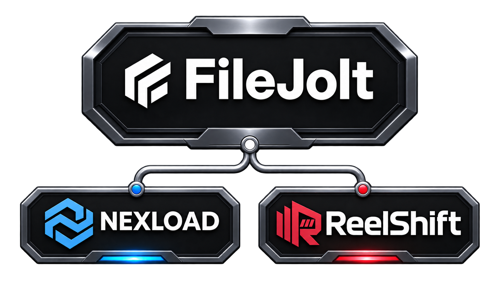

# FileJolt

### Good software. Nothing extra.

**Purpose-built Windows applications that bring order, control, and clarity to everyday file workflows.**

[Official Website](https://filejolt.github.io/) · [Explore Software](https://filejolt.github.io/software/) · [Downloads](https://filejolt.github.io/downloads/) · [Support](https://filejolt.github.io/support/)

---

## About FileJolt

FileJolt is the independent home of focused Windows desktop software. Our applications are designed around practical tasks, straightforward interfaces, and reliable everyday workflows.

Each application has its own identity and purpose. FileJolt brings them together in one place to discover products, review updates, and access official downloads.

## Our Software

| | **NexLoad** | **ReelShift** |
|:---|:---|:---|
| **Purpose** | Download and manage supported online media. | Preview, rename, and organize movies, TV episodes, and subtitles. |
| **Windows** | Windows 11 x64 | Windows 10/11 x64 |
| **Product page** | [Explore NexLoad](https://filejolt.github.io/software/nexload/) | [Explore ReelShift](https://filejolt.github.io/software/reelshift/) |
| **Releases** | [NexLoad releases](https://github.com/SleepyKevy/NexLoad/releases) | [ReelShift releases](https://github.com/SleepyKush/ReelShift/releases) |

## Download Options

**FileJolt Installer** — Install NexLoad, ReelShift, or both using the official FileJolt Windows installer.

**Portable ZIPs** — Download individual portable builds and run the software from their extracted folders.

For official download links and installation guidance, visit the **[FileJolt Downloads page](https://filejolt.github.io/downloads/)**.

## Software Signing & Windows Security

> **Important: Our Windows applications are currently not digitally signed.**
>
> This applies to all three FileJolt applications: **FileJolt Installer**, **NexLoad**, and **ReelShift**.

A digital signature allows Windows to verify a software publisher's identity and helps show whether a signed file has changed since it was signed. Because these applications are **unsigned**, Windows cannot verify their publisher through a code-signing certificate.

As a result, depending on your Windows settings and the reputation of the downloaded file, you may see a **“Unknown publisher”** message or a **Microsoft Defender SmartScreen** warning when installing or launching them.

**An unsigned application is not necessarily unsafe.** However, an absent signature also means you should **not treat the application as verified or automatically trustworthy**.

For your security, download only from the [official FileJolt website](https://filejolt.github.io/) or the official project repositories and releases linked on this page. Keep Microsoft Defender and other security protections enabled, and do not run a file if you cannot confirm where it came from.

## Explore FileJolt

- [Website](https://filejolt.github.io/) — Learn about FileJolt and its applications.
- [Software](https://filejolt.github.io/software/) — Explore available applications.
- [Updates](https://filejolt.github.io/updates/) — Review product announcements and changes.
- [Support](https://filejolt.github.io/support/) — Find help and troubleshooting information.
- [Repositories](https://github.com/orgs/FileJolt/repositories) — Browse FileJolt's public repositories.

---

**Designed for clarity. Built for utility.**

© 2026 FileJolt. All rights reserved.

